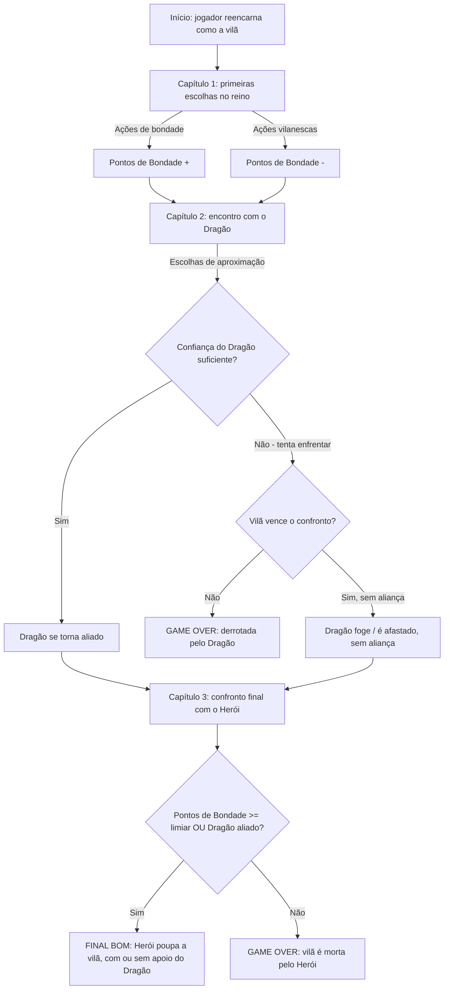

# Fluxograma e Estrutura Lógica

## Leitura do fluxo

1. **Capítulo 1** estabelece a premissa e já começa a acumular ou reduzir Pontos de Bondade a partir das primeiras escolhas do jogador — não existe estado neutro: toda decisão de diálogo/ação tem um `deltaBondade` associado (ver `docs/03-estruturas-dados.md`).
2. **Capítulo 2 (Dragão)** é o primeiro ponto de ramificação estrutural: a Confiança acumulada até aqui decide se o dragão vira aliado, se há um confronto (com risco real de game over) ou se o encontro termina sem aliança.
3. **Capítulo 3 (Herói)** é o nó final: reúne o estado acumulado das duas variáveis (Pontos de Bondade e aliança com o Dragão) para decidir entre os dois grandes desfechos.

## Finais possíveis (nós terminais)

| Final | Condição | Tipo |
|---|---|---|
| Derrotada pelo Dragão | Perde o confronto no Capítulo 2 | Game over |
| Aliança com o Dragão sem confronto | Confiança suficiente no Capítulo 2 | Transição (não é final) |
| Morta pelo Herói | Pontos de Bondade abaixo do limiar **e** sem aliança do Dragão | Game over |
| Poupada pelo Herói | Pontos de Bondade acima do limiar **ou** com aliança do Dragão | Vitória |

## Por que um grafo, e não uma árvore pura

Note que os dois ramos do Capítulo 2 (`G` e `J`) convergem de volta no mesmo nó `K`. Isso é proposital: a estrutura de dados usada (ver `docs/03-estruturas-dados.md`) é um **grafo de nós narrativos** e não uma árvore binária simples, porque caminhos diferentes podem levar ao mesmo capítulo seguinte carregando estados diferentes — é o estado acumulado (`pontosBondade`, `dragaoAliado`), e não apenas "qual nó eu estou", que determina o final.
